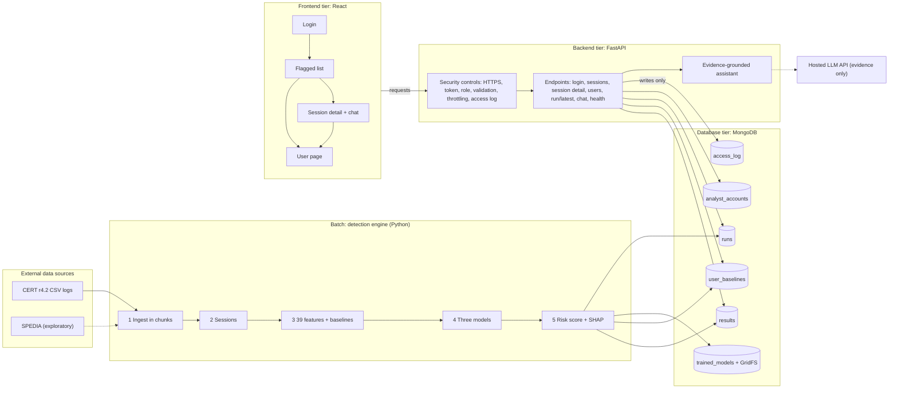

# System architecture (updated for Week 2)

Three tiers, as in the proposal, plus a batch detection engine that fills the database.

## What changed since the proposal figure
| Change | Why |
|---|---|
| `GET /api/users/{id}` and the user page | second workflow: investigate a user |
| `GET /api/run/latest` and the run panel | show when the engine last ran and its test results |
| `GET /api/health` and clear error messages | the user can tell whether the API or the database is down |
| Database validation rules, indexes and `run_id` links | consistent data; results are tied to the run that produced them |
| Login throttling and model integrity check | extra protection from the security section |

## Request flow (workflow 1 and 2)
1. The analyst signs in; the API checks the password hash and returns a token (30 minutes).
2. The dashboard asks for the flagged list; the API checks the token and role, reads `results`, writes an access-log entry.
3. The analyst opens a session (`results`) and may ask the assistant, which sees only the stored evidence.
4. The analyst opens the user page: sessions from `results`, normal behavior from `user_baselines`.

The API's only database write is the access log. The engine writes results, baselines, models and run records.
