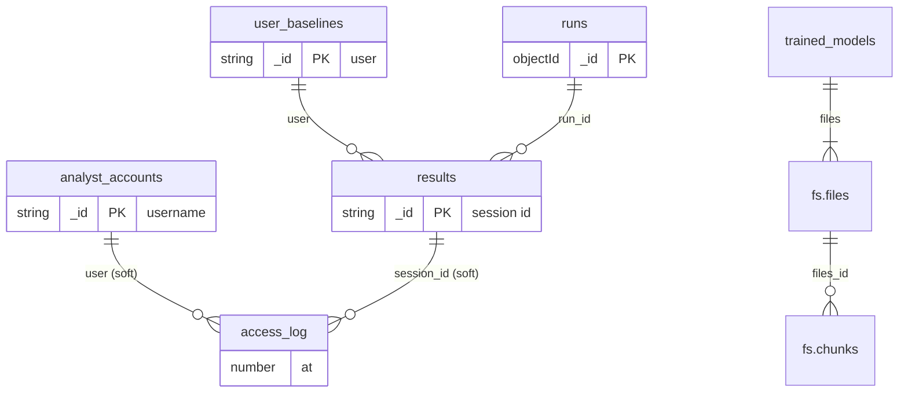

# Database schema (MongoDB, database `insider_threat`)

MongoDB is a document database, so relationships are references by value (for example `results.user` holds a
user id) and are checked by the code and by the rules below, not by foreign keys.

## Collections and fields

| Collection | One document is | Key fields | Written by | Read by |
|---|---|---|---|---|
| `results` | one scored session | `_id` = `session_id` (`S0000123`), `run_id`, `user`, `pc`, `start`, `end`, `risk_score` (0-100), `flagged`, `model_scores` (lr, xgb, iforest), `top_shap` (up to 3), `baseline_deviations` (up to 3), `label`, `split` | engine | API |
| `user_baselines` | one user's normal behavior | `_id` = user, `n` sessions seen, `mean` and `m2` for the 10 baseline metrics (running mean and sum of squares) | engine | engine, API |
| `trained_models` | the current model set | `_id` = `current`, `files` (3 GridFS ids), `sha256` (integrity), `risk` (weights, threshold), `features` (39 names), `metrics`, `trained_at` | engine | engine |
| `runs` | one batch run | `_id` (run id), `at`, `seconds`, `step_seconds`, `sessions`, `flagged`, `threshold`, `weights`, `metrics` | engine | API |
| `analyst_accounts` | one analyst | `_id` = username, `password_hash` (bcrypt), `role` (`analyst` or `admin`) | `scripts/analysts.py` | API |
| `access_log` | one audit event | `at`, `user`, `action`, `ip`, plus `session_id`, `viewed_user` or `question` depending on the action | API | API (login throttling) |
| `fs.files`, `fs.chunks` | GridFS storage of the three model files | created by GridFS | engine | engine |

## Relationships



| Relationship | Meaning | Kind |
|---|---|---|
| `results.user` to `user_baselines._id` | every user has one baseline and many sessions | by value |
| `results.run_id` to `runs._id` | every result belongs to the batch run that produced it | by value |
| `access_log.user` to `analyst_accounts._id` | who did it. A failed login may name a username that does not exist, so this is a soft reference | soft |
| `access_log.session_id` to `results._id` | which session was viewed or asked about | soft |
| `trained_models.files` to `fs.files._id` | the three saved models (lr, xgb, iforest) | by value |

## Validation rules (enforced by MongoDB)
Defined in `backend/itd/schema.py` as `$jsonSchema`. MongoDB rejects an insert or update that breaks them (error code 121).
Examples: `role` must be `analyst` or `admin`; `password_hash` must look like a bcrypt hash, never a plain password;
`risk_score` must be between 0 and 100; a result has at most 3 SHAP reasons and 3 baseline differences; `split` is
`train`, `validation` or `test`; an access-log `action` must be one of the known audit events; a stored `question`
is at most 300 characters; `trained_models.sha256` values are 64 hex characters.

```powershell
python -m itd.schema apply      # administrator, once: validation rules and indexes
python -m itd.schema check      # checks every stored document against the rules
python scripts\demo_schema.py   # shows valid documents accepted and invalid ones rejected
```
The engine account has the `readWrite` role and cannot change rules, so `apply` is run by the administrator.

## Indexes
| Collection | Index | Used for |
|---|---|---|
| `results` | `flagged`, `risk_score` descending | the flagged list, sorted by the database |
| `results` | `user`, `start` | a user's history page |
| `access_log` | `action`, `user`, `at` descending | login throttling by username |
| `access_log` | `action`, `ip`, `at` descending | login throttling by address |
| `access_log` | `at` descending | newest entries first |
| `runs` | `at` descending | the latest run |
| all | `_id` (automatic) | lookups by session id, username, user |

## CRUD: who creates, reads, updates and deletes what
| Collection | Create | Read | Update | Delete |
|---|---|---|---|---|
| `results` | engine (every run) | API | none | engine (a new run replaces the old results) |
| `user_baselines` | engine | engine, API | engine (rebuilt each run) | engine (on `--retrain`) |
| `trained_models` | engine | engine | engine (adds test metrics after training) | engine (on `--retrain`, with the GridFS files) |
| `runs` | engine | API | none | none (history is kept) |
| `analyst_accounts` | `scripts.analysts add` | API (login) | `scripts.analysts role` / `password` | `scripts.analysts delete` |
| `access_log` | API | API (throttling) | none | none (append-only audit trail) |

The API's only write is `access_log`. See the CRUD demos: `python scripts\demo_db.py` (accounts) and
`python scripts\demo_schema.py` (rules).

## Backup and restore
`python scripts\backup_db.py` and `python scripts\backup_db.py --restore <folder>`.
