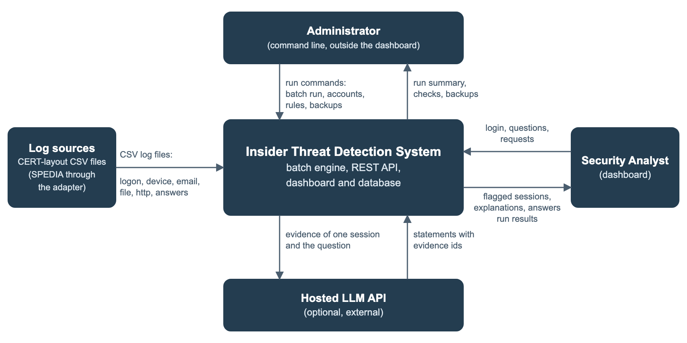
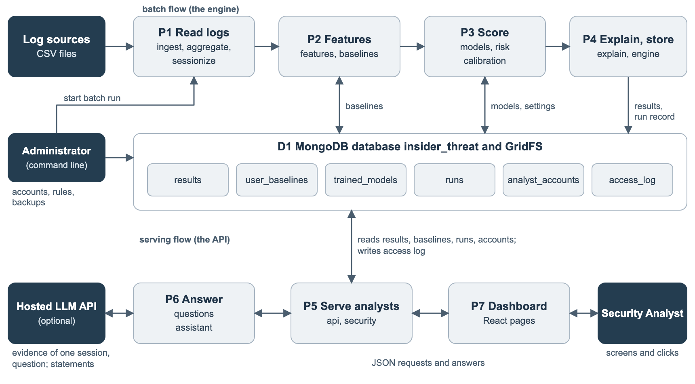

# Data-flow diagrams and component descriptions

Source text for the Word file (subsections of Section 11, "Research design and system architecture"). Written on 1 November 2026 from the code on branch `november-1-tasks-fahim`. The text between the markers is what goes into the Word file. Figures are in `docs/figures/`.

<!-- word:start -->
## Data-flow diagrams

Two diagrams show how data moves through the system. The context diagram (Figure 2) shows the system as one process and names what crosses its boundary. The level-1 diagram (Figure 3) opens that process into seven processes and one data store, the MongoDB database with its six collections and GridFS. The ten-stage workflow of Section 13 (Figure 5) describes the same flow one step at a time.

Four parties are outside the system. Log sources supply the CSV files. The administrator works on the command line and starts batch runs, manages accounts, applies the database rules and takes backups. The security analyst works only in the dashboard and receives flagged sessions, explanations, answers and run results. The hosted language model is optional and receives the evidence of one session with the analyst’s question. Nothing flows from the analyst into the stored results except access-log entries, so the analyst cannot change a score.

<!-- widths 1900,3700,2300,1993 -->
| Process | What it does | Data in | Data out |
|---|---|---|---|
| P1 Read logs | Reads the five CSV files in chunks, builds sessions and counts the events of each session. | CSV files, optional answers file | Sessions (user, PC, start, end, label) and counts per session |
| P2 Features | Builds 28 session features, 10 deviations from the user’s own history and one recency feature. | Sessions, counts, saved baselines (D1) | 39 features per session; updated baselines to D1 |
| P3 Score | Scores each session with three models, calibrates the scores, combines them and applies the flag threshold. | Features; saved models and settings (D1) | Scores from 0 to 1 per model, risk score from 0 to 100, flag; models and settings to D1 when training |
| P4 Explain and store | Adds the SHAP reasons and baseline differences and writes everything to the database. | Scores, feature rows | Result per session, run record and metrics to D1 |
| P5 Serve analysts | Checks the login, role and input of every request; reads stored data; writes only the access log. | Requests; results, baselines, runs, accounts (D1) | JSON answers; access-log entries to D1 |
| P6 Answer questions | Builds the evidence of one stored session and answers from the hosted model or a local template. | Stored session and question from P5; statements from the hosted model | Answer, evidence ids used, count of withheld statements |
| P7 Dashboard | Shows four pages and builds the CSV download; calculates nothing. | JSON from P5 | Screens, CSV file of the sessions on screen |

Three rules can be read from the diagram. Only P4 (the engine) writes results, baselines, models and runs. P5 writes only the access log. The hosted model receives only derived evidence and the question, never raw logs, user names or PC names.

## Component descriptions

The table lists each module of the repository with its job, what goes in and out, and what it depends on and how it is tested. Dependencies run one way: the API imports security, the assistant and the database code, but not the engine, the models or the risk code, and the engine imports none of the API modules. Test names are from backend/tests/test_pipeline.py.

<!-- widths 2000,3300,2300,2293 -->
| Component | Job | Input and output | Depends on and tests |
|---|---|---|---|
| ingest.py, aggregate.py | Read the five CSV files in chunks of 500,000 rows, parse dates, optionally replace user ids by keyed hashes, reduce events to per-session counts so the full log is never in memory. | In: CSV folder. Out: sessions and 16 count columns. | Uses sessionize.py. test_aggregator_counts_per_session |
| sessionize.py | Open a session at Logon and close it at Logoff, at the next Logon or after 12 hours; attach each event to the session of the same user and PC. | In: logon events, other events. Out: one row per session with an id such as S0000123. | test_sessionization_rules |
| features.py | Define the 39 features and their plain-words text; build the 28 session features, with the two day counts taken up to the current session. | In: sessions, counts. Out: feature frame. | test_feature_count, test_day_counts_use_only_the_sessions_up_to_the_current_one |
| baselines.py | Running mean and standard deviation per user (Welford), 10 deviation features, recency, and the time of the last session saved per user. | In: time-ordered frame, saved baselines. Out: deviation columns, recency, state per user. | test_baseline_uses_only_past_sessions, test_working_gap_ignores_weekend, test_running_the_same_data_again_does_not_count_it_twice, test_a_later_batch_continues_the_saved_baseline_and_recency |
| models.py | Time-ordered split 70/15/15; train Logistic Regression, XGBoost and Isolation Forest; score each between 0 and 1; serialize the models. | In: features, labels. Out: three models and their scores. | Used by engine.py. test_model_tamper_is_detected (through the engine) |
| risk.py | Calibrate each model on validation data, weight it by its validation F1, set the flag threshold at the best validation F1, compute the test metrics. | In: validation scores and labels. Out: calibrators, weights, thresholds, risk score 0 to 100, metrics. | test_risk_engine_weights_and_threshold, test_calibration_keeps_the_order_and_is_fitted_on_validation_scores, test_evaluate_model_uses_the_given_threshold_not_the_test_labels, test_stored_models_keep_calibrators_and_validation_thresholds |
| explain.py | Top three positive XGBoost SHAP contributions and top three baseline differences, in plain words. | In: XGBoost model, feature rows. Out: top_shap and baseline_deviations. | test_top_shap_is_positive_and_at_most_three |
| engine.py | Run the steps in order, save the models with SHA-256 hashes in GridFS, write results, baselines, run record and metrics file. It is the only writer of these. | In: data folder, options --retrain and --pseudonymize. Out: database documents, reports/metrics.json. | Uses all modules above. test_results_are_linked_to_their_run, test_both_workflows_end_to_end |
| db.py, schema.py | Database access with separate engine and API accounts (or an in-memory database for tests); validation rules, indexes and a checker. | In: environment settings. Out: collections with rules. | test_stored_documents_follow_the_schema, test_schema_rejects_bad_documents, test_real_mongo_enforces_the_schema (needs a server) |
| security.py | bcrypt passwords, 30-minute signed token, role check, id patterns, login throttle, access log. | Used by api.py. | test_login_and_auth, test_unknown_role_and_expired_token, test_injection_rejected, test_login_throttle_last |
| api.py, serve.py | Seven endpoints with strict request models and clear errors; HTTPS when certificates exist. | In: HTTP requests. Out: JSON. | test_list_sorted_and_detail, test_user_history_endpoint, test_latest_run_endpoint, test_health_endpoint, test_database_down_gives_a_clear_503, test_unexpected_error_hides_internal_details, test_https_required_when_enabled |
| assistant.py | Build the evidence ids R, S1 to S3 and B1 to B3 from one stored session; offline answer; hosted call with a statement check. | In: stored session, question. Out: answer, evidence ids, mode, count of withheld statements. | test_chat_names_fields_and_is_logged, test_assistant_gets_no_identifiers, test_llm_answer_is_validated, the offline answer tests and three hosted-statement tests |
| spedia.py, cross_eval.py | Convert the SPEDIA file to the CERT layout; train on one dataset and test on the other with the shared features. | In: SPEDIA CSV and mapping. Out: CERT-layout folder, cross_dataset.json. | test_spedia_adapter_and_cross_eval |
| scripts/ | Operator scripts: generate_synthetic_cert.py, build_answers.py, analysts.py, create_analyst.py, backup_db.py, check_setup.py, check_connection.py, demo_api.py, demo_db.py, demo_schema.py, run_experiments.py. | Run by the administrator on the command line. | Checked by running them (Section 21) |
| App.jsx, router.js, api.js, format.js | Hash routes, token kept in sessionStorage, return to sign-in on a 401 response, number, date and CSV formats. | In: API responses. Out: screens. | Build only; there are no frontend tests |
| pages and components | Login.jsx; FlaggedSessions.jsx with RunPanel.jsx (results table per model); SessionDetail.jsx; UserPage.jsx with RiskTimeline.jsx. | In: API responses. Out: the four pages. | Build; both workflows are tested on the API side |
<!-- word:end -->
