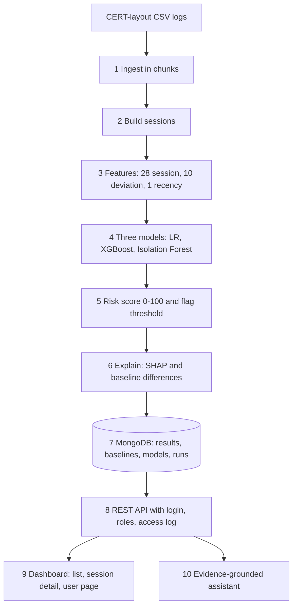

# Methodology: overall workflow and processing stages

Insider Threat Detection System (prototype), Capstone Project A, Group 7. Week 3, Day 1 (research and methodology).
Facts in this file come from the code in `backend/itd/` and from the Research and Methodology document. Where the code does not yet match the proposal, the text says so.

## 1. Approach
The project follows a design science sequence: identify the problem, define the objectives, build the artifact, demonstrate it, evaluate it, and report the findings.

| Step | In this project |
|---|---|
| Identify the problem | Insider attacks are hard to tell from normal work, and analysts cannot read all logs (proposal, Problem Statement) |
| Define the objectives | Seven objectives in the proposal: pipeline, features, models, risk score with explanation, dashboard, assistant, evaluation |
| Build the artifact | The prototype in this repository: detection engine, API, dashboard, database |
| Demonstrate | Two connected analyst workflows (`docs/DEMO.md`): review a flagged session, then investigate that user |
| Evaluate | Held-out test set in time order; precision, recall, F1 and PR-AUC; see section 4 |
| Communicate | Proposal, literature review, this methodology, final report |

The contribution is an inspectable combination of session scoring, personal baselines and explanations. It is not a new detection algorithm.

## 2. Overall workflow

Two flows share the stored results:
- Batch flow (steps 1 to 7): an operator runs `python -m itd.engine`. Only the engine writes results, baselines, models and run records.
- Analyst flow (steps 8 to 10): the analyst signs in and reads stored results. The API writes only the access log.

## 3. Processing stages

| # | Stage | Input | Rule applied | Output | Code | Test |
|---|---|---|---|---|---|---|
| 1 | Ingest | `logon`, `device`, `email`, `file`, `http` CSV files, optional `answers.csv` (`docs/CSV_LAYOUT.md`) | Read in chunks of 500,000 rows, keep only needed columns; optional user-id pseudonym (keyed hash) | Per-session event counts | `ingest.py`, `aggregate.py` | `test_aggregator_counts_per_session`, and the pipeline fixture in `test_pipeline.py` |
| 2 | Sessions | Logon events | A Logon opens a session; the matching Logoff closes it; a missing Logoff closes it at the next Logon or after 12 hours. A session is labeled malicious if it holds an event listed in the answer file | One row per user, PC and login | `sessionize.py` | `test_sessionization_rules` |
| 3 | Features and baselines | Sessions and counts | 28 session features. 10 deviation features compare the session with the same user's earlier sessions only (running mean and standard deviation, trusted after 5 sessions, capped at 10). 1 recency feature (gap since last session, weekends removed) | 39 numbers per session | `features.py`, `baselines.py` | `test_feature_count`, `test_baseline_uses_only_past_sessions`, `test_working_gap_ignores_weekend` |
| 4 | Models | 39 features | Time-ordered split 70% train, 15% validation, 15% test. Logistic Regression and XGBoost use class weights; Isolation Forest uses no labels. Trained once, saved with a SHA-256 hash, loaded to score | Three scores per session, each 0 to 1 | `models.py`, `engine.py` | `test_model_tamper_is_detected` |
| 5 | Risk score | Three model scores | Weight of each model is proportional to its validation F1. Score = 100 x weighted sum. Flag threshold = best F1 on validation data | Risk score 0 to 100, flagged yes or no | `risk.py` | `test_risk_engine_weights_and_threshold` |
| 6 | Explanation | XGBoost and feature rows | SHAP TreeExplainer on XGBoost: top 3 positive features. Top 3 positive baseline deviations. Both written in plain words | `top_shap`, `baseline_deviations` | `explain.py`, `features.py` | `test_top_shap_is_positive_and_at_most_three`, `test_list_sorted_and_detail` |
| 7 | Storage | Results of 1 to 6 | MongoDB with validation rules, indexes and a `run_id` link from each result to its run | Collections: results, user_baselines, trained_models (GridFS), runs | `engine.py`, `schema.py`, `db.py` | `test_stored_documents_follow_the_schema`, `test_results_are_linked_to_their_run` |
| 8 | REST API | Stored results | bcrypt login, 30-minute JWT, roles, strict input checks, throttling, access log, clear 503 and 500 messages | JSON for the dashboard | `api.py`, `security.py` | `test_login_and_auth`, `test_injection_rejected`, health and failure tests |
| 9 | Dashboard | API JSON | No calculation in the browser; four views with hash routes | Flagged list, session detail, user page, last-run panel | `frontend/src/` | `test_both_workflows_end_to_end` (API side) |
| 10 | Assistant | Evidence of one session: R, S1 to S3, B1 to B3 | Hosted model if `LLM_API_KEY` is set, otherwise a local template. No user or PC names are sent. Read-only | Short answer plus the evidence ids used | `assistant.py` | `test_llm_answer_is_validated`, offline answer tests |

## 4. Evaluation method
- Unit of analysis: one session (one user, one PC, login to logout).
- Split: first 70% of sessions in time order for training, next 15% for validation (weights and threshold), last 15% for the final test. No later session is used to train a model or to build the baseline of an earlier one.
- Metrics: precision, recall, F1 and PR-AUC with the malicious class as positive. Accuracy is not used because malicious sessions are very rare.
- Imbalance: class weights in training; validation and test keep their natural class balance.
- Output: `reports/metrics.json` and the `runs` collection (`GET /api/run/latest`).
- Data in this phase: generated CERT-layout data (`scripts/generate_synthetic_cert.py`). Results on it show that the software works, not how it performs on real logs. Original CERT r4.2 and SPEDIA runs come later.

Research questions to test:

| ID | Question |
|---|---|
| RQ1 | Can the pipeline turn the documented logs into explainable sessions and support both analyst workflows? |
| RQ2 | Do user-relative features improve detection over session features alone? |
| RQ3 | Does combining the three models beat each model alone? |
| RQ4 | Can the assistant answer using only the selected session's evidence? |
| RQ5 | What are the time, memory and transfer limits of this design? |

## 5. Where the code does not yet match the method
Listed in `docs/WEEK3_PLAN.md` and reviewed in section 6 below. The main ones: no score calibration, no statement-level check of hosted assistant answers, single-model thresholds chosen on test labels, two day-level features that use the whole day.

## 6. Review against the project objectives and research gaps (Day 7)
Checked on 31 October 2026 against the code on this branch. "Done" means implemented and covered by a passing test on generated data. Original CERT r4.2 and SPEDIA have not been run, so no result below is a benchmark result.

### 6.1 Objectives
| # | Objective (proposal) | Stage | Research question | Evidence | Status and limit |
|---|---|---|---|---|---|
| O1 | Pipeline from logs to behavioral sessions | 1, 2 | RQ1 | `test_sessionization_rules`, `test_aggregator_counts_per_session`, engine run in the test fixture | Done on generated data. Memory use at full CERT size not measured |
| O2 | Session-level and user-relative features from logon, email, file, web, USB | 3 | RQ2 | `test_feature_count`, `test_baseline_uses_only_past_sessions` | Done. Two day-level features use the whole day, so later sessions leak into earlier ones (issue 4). Re-running without `--retrain` replays data onto saved baselines (issue 5) |
| O3 | Compare supervised and unsupervised models | 4 | RQ3 | Three models trained and scored; metrics per model in `reports/metrics.json` | Implemented. Single-model thresholds are chosen on test labels (issue 3). No ablation (session features only versus with deviations) or equal-weight comparison run yet |
| O4 | Risk score that shows the main behaviors behind each alert | 5, 6 | RQ3 | `test_risk_engine_weights_and_threshold`, `test_top_shap_is_positive_and_at_most_three` | Implemented. No calibration (issue 1). SHAP explains XGBoost only and the heading now says so |
| O5 | Dashboard for review and investigation | 8, 9 | RQ1 | `test_both_workflows_end_to_end`, frontend build | Done: four views. Page load time in a browser not measured; the two-second check covers the API list only |
| O6 | Evidence-grounded assistant | 10 | RQ4 | `test_llm_answer_is_validated`, offline answer tests, `test_assistant_gets_no_identifiers` | Offline answers done. Hosted answers only have evidence ids filtered, no statement check (issue 2); never tried with a real key |
| O7 | Evaluate detection, generalizability and computing cost | section 4 | RQ2, RQ3, RQ5 | Metrics on a held-out time-ordered test set | Partly. Generated data only; no CERT or SPEDIA result; no calibration measures; no run time at scale |

### 6.2 Research gaps (literature review, Table 9.1)
| # | Gap | How the prototype addresses it | Status and honest limit |
|---|---|---|---|
| G1 | Alerts are not explained to the analyst | SHAP top 3 and top 3 baseline differences with every session, in plain words | Addressed in the product. Whether analysts find it useful has not been tested |
| G2 | Few studies score single sessions against a per-user baseline | Session unit; 10 deviation features against the user's earlier sessions | Addressed, with the leakage and replay limits in O2. The baseline shown on the user page is the end-of-batch state, not the state used to score older sessions |
| G3 | Results are hard to compare and may be too optimistic | Time-ordered split, precision, recall, F1 and PR-AUC, combined threshold from validation data | Partly. The code reports average precision under the key `pr_auc`. Single-model thresholds break the rule (issue 3) |
| G4 | Little testing beyond CERT | SPEDIA adapter and cross-dataset evaluation (`spedia.py`, `cross_eval.py`) | Not closed. Tested only on a stand-in file; real SPEDIA columns are not mapped; SPEDIA contains sampled CERT events |
| G5 | Research models are far from the tools analysts use | Dashboard, user page and assistant | Demonstrated as a prototype. No analyst study |

### 6.3 Inconsistencies between our documents
1. Two different sets of search strings: the Week 2 literature document and the Research and Methodology document list different seven-query sets. The search log must list only the strings that were run.
2. The proposal names five collections; the code has six (`runs` was added).
3. The proposal lists three API functions; the code has seven endpoints (login, session list, session detail, chat, user history, latest run, health).
4. The proposal and literature review say no selected study combines session scoring, a personal baseline, explanations and multi-dataset evaluation. The Research and Methodology document words this more carefully (limited evidence for this combination). Use the careful wording.
5. The proposal promises calibrated scores (Platt scaling) and a statement-by-statement answer check. Neither is implemented yet.

### 6.4 Limits to state in every report
Generated CERT-layout data only; batch processing, not live; no peer-group comparison; results show feasibility, not readiness for real logs; a flag is a lead for a human, not proof.
