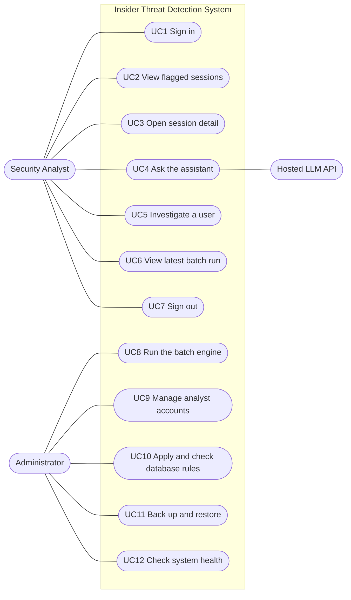

# Use cases, roles and access control

Insider Threat Detection System (prototype), Capstone Project A, Group 7. Week 3, Day 2.
Requirement ids (FR-n) refer to `docs/REQUIREMENTS.md`. Endpoints are in `docs/API.md`.

## 1. Actors
| Actor | Who | How they use the system |
|---|---|---|
| Security Analyst | Member of the security operations team | Works only in the dashboard. Read-only access to results |
| Administrator | A team member who runs the prototype | Works on the command line, not in the dashboard: places the log files, starts the batch run, manages accounts, applies database rules, takes backups |
| Hosted LLM API | External service (optional) | Receives the stored evidence of one session and a question, returns an answer |

CERT r4.2 and SPEDIA are data sources outside the system.

## 2. Use-case diagram

Order of use: UC1 comes first. UC2, UC3, UC5 and UC6 need a valid token. UC3 can lead to UC4 and UC5, and UC5 leads back to UC3 (the two connected workflows in `docs/DEMO.md`).

## 3. Use case descriptions

### Security Analyst

**UC1 Sign in** (FR-9, FR-13) `POST /api/login`
- Precondition: an account exists in `analyst_accounts`.
- Main flow: the analyst enters a username and password. The API checks the bcrypt hash and returns a token valid for 30 minutes. The dashboard keeps it for the browser session.
- Alternatives: wrong password gives 401 "Wrong username or password". Five failed logins for a username or address in 15 minutes gives 429. Input with database operators gives 422. Database down gives 503 with a retry message.
- Postcondition: an access-log entry `login_ok` or `login_failed`.

**UC2 View flagged sessions** (FR-10) `GET /api/sessions`
- Precondition: signed in with a valid token.
- Main flow: the dashboard shows the sessions at or above the flag threshold, highest risk first, with the counts and the threshold.
- Alternatives: missing or expired token gives 401 and the dashboard returns to sign-in with a notice. No batch run yet gives an empty list. Database down gives 503 and "Try again".
- Postcondition: none stored.

**UC3 Open session detail** (FR-7, FR-10, FR-13) `GET /api/sessions/{id}`
- Precondition: signed in; the id is a session from the latest run.
- Main flow: the analyst opens a row. The page shows the 0 to 100 score, the three model scores, the top three SHAP reasons, the top three differences from the user's normal, and the notice that a flag is not proof.
- Alternatives: id not in `S<digits>` form gives 422. Unknown id gives 404 "That session was not found. It may belong to an older run."
- Postcondition: access-log entry `session_viewed`.

**UC4 Ask the assistant** (FR-8, FR-13) `POST /api/sessions/{id}/chat`
- Precondition: UC3 is open.
- Main flow: the analyst types a question (at most 300 characters). The API builds the evidence of that session only (R, S1 to S3, B1 to B3; no user or PC names), asks the hosted model or answers from a local template, and returns the answer with the evidence ids used.
- Alternatives: no API key, or the hosted call fails, gives the offline template answer. Longer question gives 422.
- Postcondition: access-log entry `assistant_question` with the question. The assistant cannot change a score or flag.

**UC5 Investigate a user** (FR-11, FR-13) `GET /api/users/{id}`
- Precondition: signed in; started from a session or a link.
- Main flow: the page shows the user's sessions over time (default latest 500), the flag threshold, a summary and the ten normal-behavior values. The analyst opens another session from the timeline.
- Alternatives: bad id gives 422; unknown user gives 404.
- Postcondition: access-log entry `user_viewed`.

**UC6 View latest batch run** (FR-12) `GET /api/run/latest`
- Main flow: shows when the engine last ran, how long it took, threshold, model weights and test results.
- Alternative: no run yet gives 404 "No batch run recorded yet. Run the detection engine first."

**UC7 Sign out**
- Main flow: the dashboard removes the token from the browser session.
- Limit: the token is not revoked on the server; it stays valid until it expires (30 minutes).

### Administrator

**UC8 Run the batch engine** (FR-1 to FR-7, FR-14) `python -m itd.engine --data <folder> [--retrain] [--pseudonymize]`
- Precondition: the five CSV files (and optional `answers.csv`) are in the folder; MongoDB is running.
- Main flow: ingest, sessions, features, models, risk score and SHAP, then results, baselines, models and a run record are saved.
- Alternatives: a missing file stops the run with a clear message. Train, validation or test without a malicious session stops the run. A saved model that fails its SHA-256 check stops the run with "Retrain with --retrain".
- Postcondition: new `results`, `user_baselines`, `runs` (and models if retrained).

**UC9 Manage analyst accounts** `python -m scripts.analysts list|add|role|password|delete`
- Main flow: the administrator creates or changes accounts. Roles are `analyst` or `admin`.
- Alternative: any other role is refused by the script and by the database rule.

**UC10 Apply and check database rules** (NFR-8) `python -m itd.schema apply|check`
- Main flow: creates or updates collections with strict validation rules and indexes; `check` tests stored documents against the same rules.

**UC11 Back up and restore** `python scripts/backup_db.py --out <folder>` and `--restore <folder>`

**UC12 Check system health** `GET /api/health` (no login), `scripts/check_connection.py`, `scripts/check_setup.py`
- Main flow: reports whether the API is up and can reach the database (200 ok or 503 degraded).

## 4. Roles and access control

Rules in the code: `security.py` (`current_user`, `require_analyst`), `api.py`, `schema.py`.

| Endpoint | No token | Invalid or expired token | Role analyst | Role admin | Any other role |
|---|---|---|---|---|---|
| `GET /api/health` | 200 | 200 | 200 | 200 | 200 |
| `POST /api/login` | allowed | allowed | allowed | allowed | allowed |
| `GET /api/sessions` | 401 | 401 | 200 | 200 | 403 |
| `GET /api/sessions/{id}` | 401 | 401 | 200 | 200 | 403 |
| `POST /api/sessions/{id}/chat` | 401 | 401 | 200 | 200 | 403 |
| `GET /api/users/{id}` | 401 | 401 | 200 | 200 | 403 |
| `GET /api/run/latest` | 401 | 401 | 200 | 200 | 403 |

Notes:
- Analyst and admin have the same rights on the API. No endpoint is admin-only. Administration is done on the command line (UC8 to UC12). A user-administration screen is out of scope.
- The database allows only the roles analyst and admin, so "any other role" can only occur with a forged or old token.
- The API writes only to `access_log` (`login_ok`, `login_failed`, `session_viewed`, `user_viewed`, `assistant_question`). Results, baselines, models and runs are written by the engine only.
- With the secure database set-up (`docker-compose.secure.yml`, `docs/SECURITY.md`), the API account is also denied writes outside the access log at the database level. In the default development set-up this separation is not enforced.
- Other controls: 30-minute token, strict request models, session and user ids limited to a fixed pattern, login throttling, HTTPS when `REQUIRE_HTTPS=1`.
- Development defaults to change before any real use: `JWT_SECRET` has a built-in value (`config.py`), and HTTPS is off by default.
